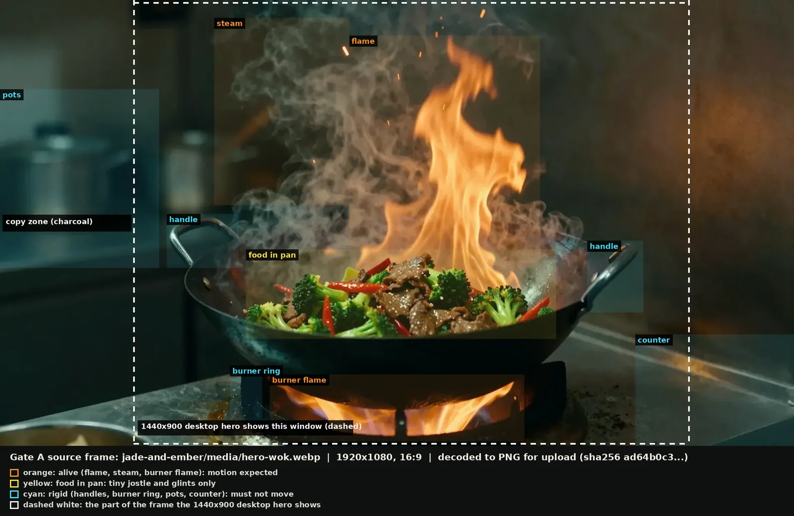

# Jade & Ember — Gate A pre-flight record

**Status:** Step 0 complete. Waiting for source-frame approval. **Nothing has been uploaded or generated.**
**Parent plan:** `docs/JADE_AND_EMBER_HERO_VIDEO_PLAN.md`. **Date:** 2026-10-09.
**Authorised so far:** one Kling 3.0 Omni attempt, maximum 5 credits, subject to a fresh cost check, after this source frame is approved. No ingredient toss, no portrait video, no extra attempts, no deployment.

---

## 1. Source frame for approval

| Property | Value |
|---|---|
| File | `jade-and-ember/media/hero-wok.webp` (the live poster) |
| Frame to send | The poster decoded losslessly to PNG: 1920×1080, RGB, no colour profile, 1.1 MB |
| SHA-256 of that PNG | `ad64b0c3015796a81ab05528aa18443df00e1da892438ba364866d1bc79831c0` |
| Reproducible from the repo | Yes: `Image.open("jade-and-ember/media/hero-wok.webp").convert("RGB").save("poster.png")` |
| Origin | Z-Image-Turbo, seed 2202, split-tone graded (`media/PROVENANCE.md`) |

**Why the poster itself, not a re-export:** I compared it with a lossless re-grade made straight from the generator's original (before the poster's WebP compression). They differ by PSNR 40.6 dB, mean absolute difference 1.5 levels out of 255, which is not visible. Using the poster means the first frame of any video is exactly what visitors already see, and the frame can be recreated from the repository at any time.

**Review against Part VI.5:**
- The intended motion is already obvious in the frame: a tall flame, a steam plume, sparks, food in the pan.
- Light is one warm ember source with a faint cool tint in the shadows; the prompt uses the same words.
- Nothing unwanted is present: no people, hands, text, vehicles. Remaining objects are rigid (pots, counter, handles, burner) and are on the "must not move" list.
- Visible weaknesses of the frame (honest list): the flame is one large frozen flare, so a loop may look calmer than the still; the steam and smoke are grey and merged, so the model may read them as smoke; a bowl corner sits at the bottom left (outside the desktop hero crop); the food is plausible AI food, not studio photography.
- Delivery box: the desktop hero shows the dashed window in the preview (about 70 % of the width). The copy sits on charcoal to the left of that window.

**Decision requested:** approve this frame as the single start and end frame, or name a change (a different still, a different crop, or a retouch) before any upload.

## 2. Measurement regions (changed from the plan)

The dry run showed that overlapping regions let one region's motion contaminate another's measurement, so the regions are now disjoint. Percent of the 1920×1080 frame, `x0, y0, x1, y1`:

| Region | Box | Role |
|---|---|---|
| flame | 44, 8, 68, 56 | alive |
| steam (left of the flame) | 27, 4, 44, 46 | alive |
| burner flame | 34, 84, 66, 99 | alive |
| food in pan | 31, 56, 70, 76 | tiny jostle only |
| left handle | 21, 48, 30, 60 | rigid |
| right handle | 74, 54, 81, 70 | rigid |
| burner ring | 29, 82, 33, 95 | rigid |
| pots | 0, 20, 20, 60 | rigid |
| counter | 80, 75, 100, 100 | rigid |

## 3. Synthetic QA dry run (step 0)

Tools added: `jade-and-ember/tools/video-qa.py` (the checker) and `jade-and-ember/tools/video-qa-selftest.py` (the dry run). Run with `python3 tools/video-qa-selftest.py` from `jade-and-ember/`; it takes about 1.5 minutes, needs `ffmpeg`, NumPy and Pillow, and costs nothing.

The dry run builds 5 s, 24 fps, 1280×720 clips **from the real poster** with known motion or known faults, encodes them with x264, and checks that the checker passes the good clip and catches each fault.

| Synthetic clip | Result | Checks that failed |
|---|---|---|
| Good closed loop (flame shear and flicker, steam drift, tiny food jostle, grain) | passes everything, including "frame 0 matches the poster" | none |
| Frozen scene | caught | flame and steam are alive |
| Wobbling frame | caught | rigid objects (and food) |
| Food morphs mid-clip | caught | food keeps its look (also endpoints, seam) |
| Flame ends somewhere else | caught | endpoints match, seam |
| … then the crossfade-loop fallback applied | **passes** | none (fallback verified) |
| Strobing brightness | caught | flash proxy (also drift, food, rigid) |
| Luma drifts +15 % | caught | no luma drift (also seam) |
| Has an audio track | caught | silent |
| Too small (960×540) | caught | resolution |

**Calibration findings (these changed the tool and the plan):**
1. Full-resolution SSIM failed a good clip because film grain and codec noise dominate dark regions. Metrics now run on frames averaged 4× down.
2. Step-ratio checks exploded on near-static regions (division by a near-zero median). A floor of 0.05 was added; a frozen clip is caught by the "alive" check instead.
3. The loop-seam threshold moved from 1.5× to **3.0×** the median step. The cause is the codec: the first frame is an intra frame and later frames are cleaned up, so a closed loop can differ at the cut by more than a typical step. This was calibrated on synthetic clips only.
4. "Alive" thresholds (flame ≥ 0.25, steam ≥ 0.15 mean frame-to-frame change on the 4× frame) were set from the good synthetic clip with a margin.

**Limits of the dry run:** synthetic motion is simpler than real generated motion, so every threshold is a starting default to be recalibrated on the first real clip. The flash check is a proxy from frame-mean luminance, not a certified WCAG 2.3.1 test. The checker cannot see morphing food detail, texture swimming, edge crawl, melted detail or new objects: those stay a human review of first, middle and last frames and the clip looped twice.

## 4. The one authorised trial: exact spec (not yet executed)

| Item | Value |
|---|---|
| Model | Kling 3.0 Omni (Frames), `kling_o3_flf` |
| Mode and audio | `std`, sound `off` |
| Duration, ratio | 5 s, 16:9 |
| Count | 1; no preset; no prompt enhancement; no variants |
| Start and end image | The PNG in section 1, the same file for both |
| Prompt | As in `docs/JADE_AND_EMBER_HERO_VIDEO_PLAN.md`, section 5 |
| Cost | Quoted 5.0 credits on 2026-10-09. A fresh `get_cost` with the image attached runs first; the job is not submitted if it is above 5.0 |
| Balance | 240.5 before; expected 235.5 after |
| After the job | Download the clip, run `tools/video-qa.py` against the poster, view first, middle and last frames and the looped clip, and report. No integration, no second attempt |

**Unknowns that could end the trial early (reported, not worked around):**
- It is not stated whether this model accepts the same image as both start and end frame. If the request is rejected before running, I will report that and stop; I will not switch model or spend more without approval.
- Native output size in `std` is unconfirmed (expected 1280×720).
- The model could treat "end = start" as a reason to hold still. The checker's "alive" row and the visual review will show it.

**Sequence after your approval of the source frame:** (1) save the PNG; (2) upload it to your Higgsfield account; (3) fresh cost check with the media attached; (4) submit one job; (5) wait for it; (6) download, QA, report.
